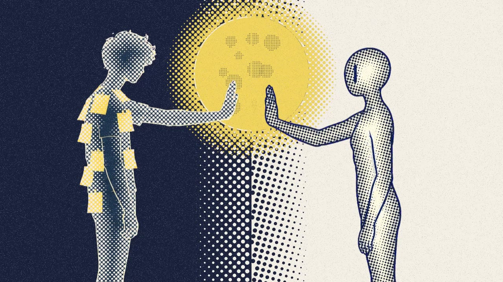
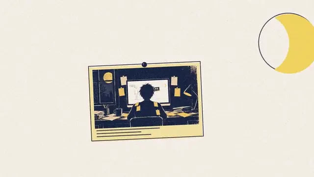
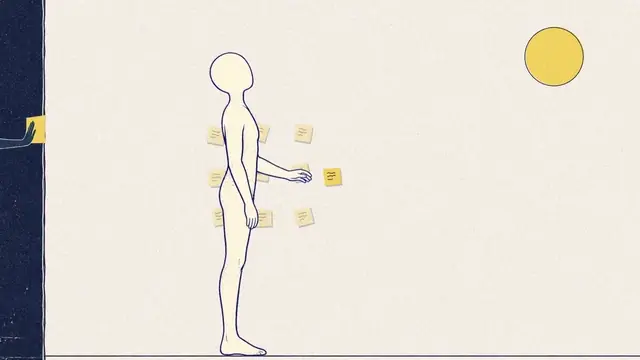
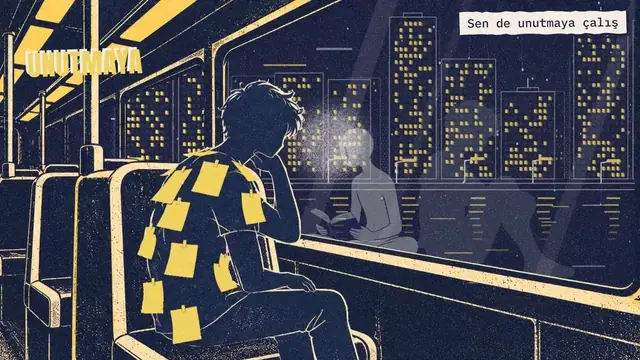
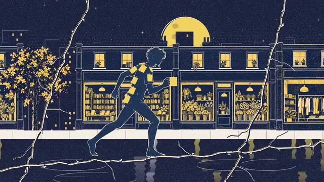
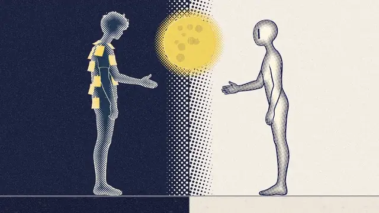

# Her Sabah Baştan

**Watch it on YouTube: [Her Sabah Baştan (Start Over Every Morning) || Opus 5.5 Music Clip](https://www.youtube.com/watch?v=j-LT1IEJDvk)**



*Her Sabah Baştan* ("start over every morning") is a 4:01 Turkish duet about an AI that meets its
human for the first time every morning. The human keeps a notebook; the AI reads it each day, understands
it, and still does not remember. The film is two-colour silk-screen print in navy, moon yellow and cream.
The cream figure is the AI, drawn as a blank mannequin with a cursor slit for an eye. Every sung line is
tied to a measured word time, and every cut lands on a measured beat.

Final render: 2560x1440, 60 fps, 14,446 frames, 240.77 s (each part rendered with `--scale=1.3333333333333333`,
then assembled; a 1080p master exists too). Code, drawings and prompts are in this folder.

## Excerpts

Each excerpt is 3.5 to 4 s from the final render, shown at 15 fps.

<table>
<tr>
<td width="50%" valign="top"><br>
<b>0:07</b> The title card, then the camera falls into the room (the Droste intro).</td>
<td width="50%" valign="top"><br>
<b>0:43</b> "Bir defter buldum önümde": the AI finds the notebook.</td>
</tr>
<tr>
<td width="50%" valign="top"><br>
<b>2:30</b> Night bus. The AI's reflection draws a heart in the fogged glass.</td>
<td width="50%" valign="top"><br>
<b>2:43</b> A navy ink wave rolls over the AI; the human's sticky notes fly off.</td>
</tr>
<tr>
<td width="50%" valign="top"><br>
<b>3:44</b> Palms meet on the moon. The heart from the bus is printed between them and the frame floods one colour.</td>
</tr>
</table>

## How it was made

One person directed. Claude Opus 5.5 (Claude Code main loop) was the architect: it wrote the scene map,
the contracts, the checks, and it looked at every result before the director did. Sonnet and Opus 5.5
sub-agents built separate parts of the film in parallel lanes. In this project Codex generated pictures
only; it wrote and reviewed no code. Dates below are October 2026.

### Pipeline

1. **Song first (18 Oct).** The song came from Suno (Pro plan; the repo does not record a version number).
   Before any drawing, `tools/timing/` measured it with librosa and faster-whisper: beats, downbeats,
   sections and word times, stored in `data/timing.json`. Length 4:00.76. The tempo drifts from 127.9 to
   130.9 BPM, so every event indexes the measured `beats[]` array, never a fixed BPM. A fixed BPM would
   drift 1.6 s by 4:00. Lyrics are bound only to measured word times. Guessed times were wrong every
   time they were tried.
2. **Style frames.** Round 1 drew eight styles of an empty room and all eight read as the same lo-fi
   template. The style only worked once there was a character and the song's own objects (notes, glass,
   moon). Round 2 chose the silk-screen print look (`stil/tur2/03-ipek-baski.png`); rounds 3 and 4 made
   the key frames (24 frames and 15 tables in `stil/tur4/`). Palette: navy `#18203A`, moon yellow
   `#F0D35A`, cream `#F3EFE4`; lime `#C9D94A` only on the lamps that light green for a false success; red
   only on emotion icons.
3. **Characters from Codex image generation.** Code-drawn SVG characters looked like pills, so every pose
   is a drawing from Codex image generation on a magenta background, cut out with a flood fill and a
   check that no magenta fringe pixels remain inside the alpha edge.
4. **The film in code.** Remotion (React) and Three.js: a multiplane camera over flat layers, one WebGL
   canvas per frame, no post-processing. The film was built in four parts (0:00 to 0:58, 0:57 to 1:51,
   1:51 to 2:36, 2:36 to 4:01). Parts 2 and 3 were built at the same time by two lanes. The architect
   fixed the hand-over frame in both briefs first (part 2 ends on one yellow dot at a given pixel, part 3
   opens it as the sun), so the lanes never had to talk. The part renders are joined by
   `video/scripts/assemble-parts.sh` without re-rendering.
5. **Checks before showing.** See the list further down.
6. **60 fps.** The scenes run on a 30 fps clock. Each part is rendered at 60 fps by a wrapper that gives
   every frame half-frame time (`video/src/living/fps60/`), with no new in-between drawings, then joined
   (cuts at song frames 1706, 3340, 4676, 6396; expected 14,446 frames).

### What was tried and dropped

The animation method took four attempts. Each one passed its own measurements and failed when a person
watched it.

| Attempt | What the numbers said | What the director saw | Result |
|---|---|---|---|
| Key-pose drawings with silhouette morphs between them | All gates green: tempo, jumps, popping props, detail | Arms smeared into blobs, a doubled body standing from a chair, legs smearing into a tail. The gates measured timing and jumps, not whether the body in the middle of a transition is plausible. | Dropped. Morphing does not know where a limb is. |
| Simple 3D bodies in Blender, flat shaded | 540 of 540 frames with one connected silhouette, bone length deviation 0.002 %, largest frame-to-frame silhouette change 4.1 % | A cartoon mannequin instead of the illustrated person | Dropped. Anatomy fixed, look lost. |
| 2D bone rig in Blender with mesh-deformed joints from our own drawings | One silhouette per frame, bone length deviation 0.0001 %, foot slip 0.13 px | Legs through the chair and desk, a ball-shaped sit, an oddly bending walk | Dropped. Perfect geometry, wrong acting. |
| **Living illustration** | | "Gayet iyi, buradan gidebiliriz" (pretty good, we can go on from here) | **Kept.** |

The lesson from the three failures: geometry measurements say nothing about whether acting reads as human,
and everyone knows how a body moves. In the living illustration, big actions are told, not animated. Each
beat is a complete drawn pose. Poses change through print transitions, cuts on the beat, match cuts and the
camera. Inside a pose only small life moves: breath, a slight head turn, hair, steam, a blink. The
director's favourite part of the film is the notebook sequence, which is the most motion-design part:
flat close-ups, cuts on the sung words, ink lifting off paper.

Other things dropped:

- **Water-like scene changes in code.** Ripple rings read as a preset, and a pure refraction version
  still read as an ink blob. Veo 3.1 interpolation was tried through the Gemini API (the free tier
  returned 429 for all three models) and the browser version adds a visible watermark, so it was not used.
  The film uses five print-language transitions instead: halftone bloom, ink bleed, paper fold, squeegee
  print, plate shift (`video/src/transitions/`).
- **A white reset room.** The "white" room after a reset was a neutral grey outside the palette; it became
  a cream haze.
- **A first finale.** The director found the end flat, especially after the glass shatters. It was
  rebuilt as two print plates coming into register: after the glass breaks, everything is reprinted as
  one moon-yellow field with the human and the AI as two matching outlines. Four earlier moments hint at
  it: where the two palms really touch (the café, the pressing scene in part 4, the "bir daha" line), a
  moon-yellow palm imprint is printed, and one moment prints a yellow notch on the AI's side.
- **A torch scene** ("Güveniyorum ama bakıyorum") whose metaphor did not read. A magnifying glass that
  checks the AI's boxes replaced it.
- **Sound effects.** Candidates exist in `sfx/candidates/`; the director decided the film needs none.

### Checks

- `tools/beatcheck.mjs` recomputes every event frame from `data/timing.json` and fails on drift. I reran
  it for this README: 470 events, maximum drift 0 frames. It reads `video/src/events.ts`, which has no
  events from the bridge on, so it does not cover the whole song.
- `video/scripts/living-checks.mjs`, `jumpcheck.mjs`, `stillness.mjs`, `repcheck.mjs`, `tempocheck.mjs`
  and others scan renders for one-frame jumps, long still holds, repeated framings and tempo.
- Frames are inspected by number (`ffmpeg select='between(n,A,B)'`); `-ss` seeking returned the wrong
  frames.
- Gemini watched renders at 10 and 24 fps as a second pair of eyes. Its overall verdicts were useful; its
  frame-level timestamps were often wrong, and every claim was checked at full frame rate. A blind Sonnet
  watcher caught readability problems the gates passed.
- Chrome sometimes captured a corrupted frame (the top-left third tiled 3x3) at render concurrency 2 or 4.
  Every render is scanned for that signature and each bad frame is rendered alone as a still and spliced
  back (`video/src/living/fps60/repair-tiles60.mjs`).
- The first 60 fps assembly had 423 blank cream frames. The cause was an intro table indexed by a
  fractional frame (`STAMP_SQUASH[sinceStamp]`, giving a NaN scale). The fix was commit `5f2deb4`; all
  frames at whole indices render the same as before.

## Layout

- `sarki/` lyrics and Suno brief; the master WAV lives here but is not committed (46 MB).
- `data/timing.json` measured beats, downbeats, sections, words.
- `stil/` style frames and the prompts that made them (tur 2/03 is the style; tur 4 holds the key frames).
- `tools/timing/` measurement scripts.
- `video/src/living/` the film: engine, parts `part1` to `part4`, 60 fps wrappers in `fps60/`.
- `video/src/transitions/` the five print transitions.
- `docs/process-log.md` the dated working log this README is drawn from.
- `sahne-haritasi.md` the first scene map (typography rules still apply).

## Success metric (fixed before the first commit)

Every beat-locked event drifts **0 frames** from its measured beat, and the final render has **0 render
errors**.

## Running it

```bash
cd her-sabah-bastan
node tools/beatcheck.mjs                         # beat lock check
python video/scripts/make-strips.py              # see Known issues: public/strips is not in git
cd video
npm ci
cp <song>.wav public/her-sabah-bastan.wav        # see Known issues: the song is not in the repo
npx remotion studio src/living-index.ts          # preview the film compositions
```

The film compositions are in `src/LivingRoot.tsx`: `Part1At60`, `Part2At60`, `Part3FullAt60`,
`Part4aAt60`, `Part4bAt60`. The session notes record rendering each with `--muted`, CRF 18 and
concurrency 1 to 2. Then:

```bash
FPS=60 bash scripts/assemble-parts.sh part1.mp4 part2.mp4 part3.mp4 part4a.mp4 part4b.mp4 out/klip.mp4
```

`assemble-parts.sh` lays the song under the film in one piece.

## Known issues

- **A clean clone does not open.** `video/public/strips/` is in `.gitignore`, but `assets.ts` loads it
  on start, so the root fails with "source image cannot be decoded". `video/scripts/make-strips.py`
  rebuilds the folder (217 files) from `stil/hareket/kare/`, which is tracked. I have not run it on a clean
  clone.
- **The song is not available.** `sarki/*.wav` is ignored and no release holds it. The only release in
  the repo is a draft for the other clip.
- **The final MP4 is on YouTube only** (linked at the top), not in the repo or a release. `video/out/` is ignored.
- `tools/beatcheck.mjs` does not cover the whole song (see Checks), and the scene code runs on a 30 fps
  clock, so the check constants still say 30 fps.
- Small defects the architect listed and left: a flat cream glass shard covers the AI for a few frames
  around song frame 6452, and the AI's head is slightly small in the stretching pose.
