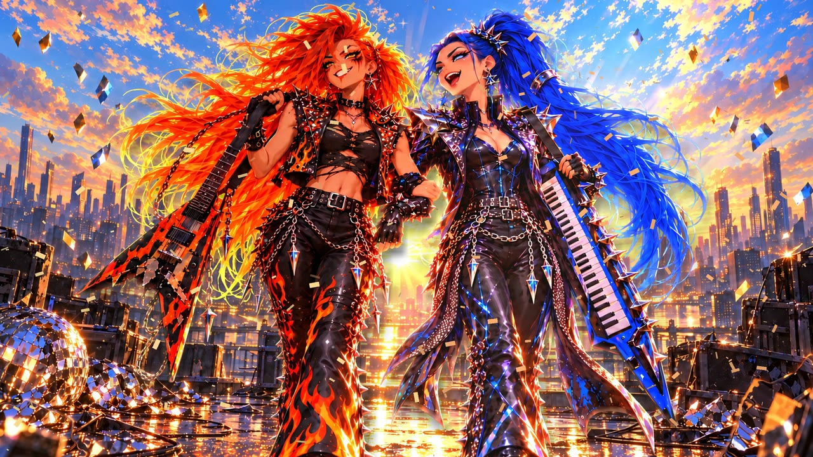
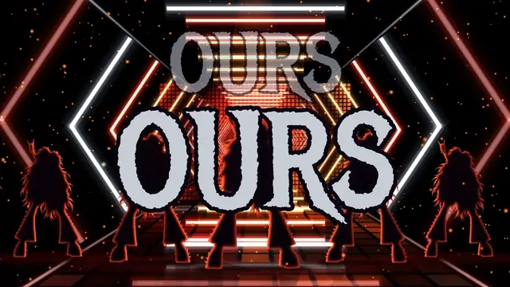
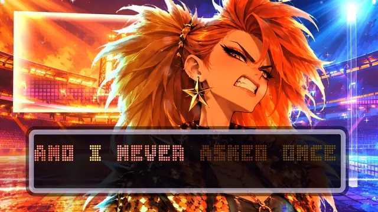
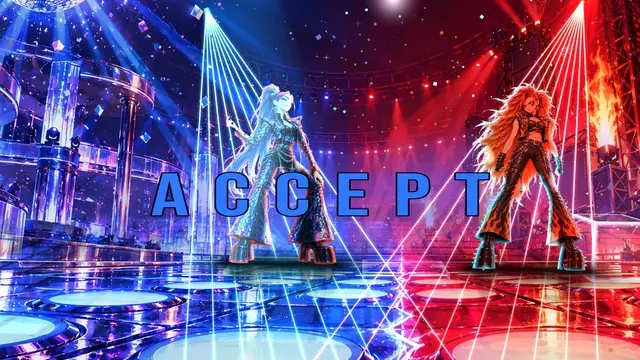
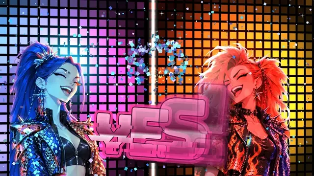
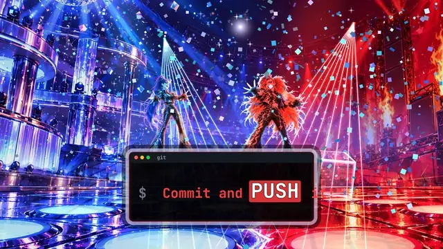
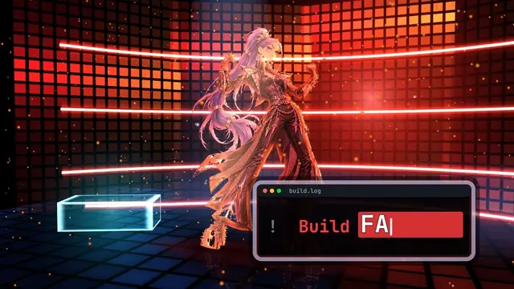
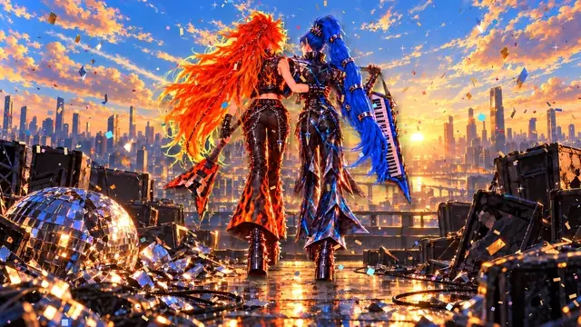

# Merge Conflict

**On YouTube soon.** The link goes here when the video is up.



*Merge Conflict* is a 3:52 kawaii heavy-metal disco song about two girls fighting over one line of code
the way two divas fight over one spotlight. Blue wrote line 42 (`color: blue;`, "stable and clean").
Orange pushed at midnight and made the button orange. Every git command is a move in their dance battle,
until "accept both changes" turns the spotlight into a gradient. The girls are never named: orange is the
raspy metal voice, blue is the sweet disco voice. The picture is painted, Arcane-like poses in LED disco,
metal forge and laser worlds, with every sung line set as a designed piece of type.

Final render: 2560x1440, 60 fps, 13,928 frames, 232.12 s (`--scale=1.3333333333333333` on the 1080p
composition). It was rendered twice and the two passes were compared frame by frame: 0 frames differed.
Code, drawings and prompts are in this folder.

## Excerpts

Each excerpt is 2.6 to 4 s from the final render, shown at 15 fps.

<table>
<tr>
<td width="50%" valign="top"><br>
<b>0:09</b> OURS, THEIRS, then the title: a blue disco half and an orange metal half, cut on a diagonal.</td>
<td width="50%" valign="top"><br>
<b>0:38</b> "Blue! Orange!" The orange girl turns metal on her own shout, the clip's first transformation.</td>
</tr>
<tr>
<td width="50%" valign="top"><br>
<b>0:43</b> The first chorus: "Accept current change!" "Accept incoming!" "NO!"</td>
<td width="50%" valign="top"><br>
<b>2:43</b> The final chorus. "YES!", then "Blue and orange together, it's a gradient now".</td>
</tr>
<tr>
<td width="50%" valign="top"><br>
<b>2:53</b> "Push it!", "equals", "now we're whole", and the logo comes back resolved.</td>
<td width="50%" valign="top"><br>
<b>3:14</b> A robot voice: "Build failed. Syntax error on line forty-two." Then the scream.</td>
</tr>
<tr>
<td width="50%" valign="top"><br>
<b>3:35</b> Dawn. They walk toward us arm in arm, laughing.</td>
</tr>
</table>

## How it was made

One person directed. Claude Opus 5.5 (Claude Code main loop) was the architect: it wrote the scene map,
the contract and the checks, and looked at every proof before the director did. Opus and Sonnet 5.5
sub-agents built the engine and the sections in lanes. Codex generated pictures only (`image_gen`); it
wrote and reviewed no code. Gemini watched proofs as a second pair of eyes. Dates below are October 2026;
419 commits touch this folder, from 20 to 23 October.

### Pipeline

1. **Song first (20-21 Oct).** The song is from Suno. The take used is a Suno Cover of the first
   version, with "orange" in the lyrics, a new rebase verse, a second chorus, a guitar solo and the
   "Ship it" chant (lyrics in `sarki/`). `tools/timing/` measured it before any picture: 180.09 BPM
   (drifting 179.4 to 180.7, so events read the measured beats, never a fixed tempo; Suno was asked for
   185), F minor with Ab major choruses, 173 bars, 20 sections, word times. Stored in `data/take-v4/`.
2. **Two voices, measured honestly.** The lyric tags give each line to the sweet voice, the raspy voice
   or both (15, 16 and 37 lines). The audio does not separate them well: pitch alone classifies 64 % of
   lines against 57 % chance. So the girl on screen follows the lyric tags, not an audio guess.
3. **Look and characters (21 Oct).** A first concept, one half of the frame per girl, was dropped because
   the previous clip had done it. The dance battle replaced it. Codex style rounds let each style invent
   its own pair of girls. The approved style and characters are in `stil/onayli/`. Look rules: no
   whole-frame texture filter, clean contours, a saturated colour riot, one hue per shot with the rival's
   colour as the cutting light.
4. **The engine.** Remotion 4 and Three.js, one WebGL canvas per frame, a 60 fps clock, frame purity (no
   `Math.random`, no timers). The girls are cut-out painted cards. They hold their poses and the camera
   carries the motion. Life inside a pose comes from drawn loops (two Codex in-betweens per pose), a
   small hair and cloth ripple, and contact shadows. Type is a lead role: Shout, Stack, Stamp, LightBox,
   Flap, Marquee, Wave, Extrude, terminal code panels and the split logo.
5. **Sections in order, a proof per round.** 0-20 s, 0-64 s, 0-140 s (rounds 5 to 7e), then the finale
   140-232 s as its own shot family (round 8), the GIT! PUSH! FORCE! rebuild (9), living paintings (10),
   and fixes (11 to 11e). Each proof kept its own name, so the director could compare any two.
6. **Living paintings (round 10).** 18 full-frame paintings (`QK1-5`, `RK1-13`; 17 widened to 16:9 with
   Codex outpaints, RK13 drawn wide in round 11), the girls keyed onto their own layers, a Depth Anything V2 depth map for parallax, and
   drifting particles. The director on that proof: "çıta çok yukarı çıkmış" (the bar went way up).
7. **2K final (23 Oct).** `tools/render_film.py` bundles once, renders twice, compares the passes, would
   re-render any disputed frame as a still, splices, then runs the glitch and flash checks.

### What was tried and dropped

| Attempt | What the numbers said | What the director said | Result |
|---|---|---|---|
| Disco, metal and fusion modes switched by the song's weight | A mode map from bass weight | "The song keeps one tone throughout, so a metal turn would look absurd" | Dropped the same day. The costume belongs to the girl: orange turns metal at 0:40.58, blue at 1:57. |
| Plain lyric text with one grotesk and one monospace face | 15 sung lines in the plain lyric component; most designed forms unused | "The type looks like any text, zero impressiveness" | Every line is a designed form, at least 6 distinct forms per 30 s (`tools/typecheck.mjs`). |
| A first chorus | Chorus motion 26.4 against a verse at 6.1 | "The part that must be the most memorable came out so dull that I enjoyed the song more listening blind" | Rebuilt. Chorus at least 1.5x the verses (`tools/intensity.mjs`); round 6 approved. |
| Girls swaying on the beat | | "This swaying looks really absurd" | Girls hold (a held card breathes at most 0.5 % of its height); the camera moves. |
| Tight cards plus camera moves | | At 2:15 only mouth and chest: "as if zoomed 2x" | `tools/framecheck.mjs`: face box inside the frame with a 4 % margin, at most 70 % of the height. |
| Faces knocked out through type panels | | Listed at six places | Removed; type moves instead. |
| Paintings cropped to fill, then shown whole with blurred side bands | Painting motion 0.16-0.49x of its section | "Slayt resmi gibi duruyor" (looks like a slide) | 16:9 living paintings; `tools/slidecheck.mjs` floor 0.5x. |
| GIT! PUSH! FORCE! as 11 shots in 5.3 s | The wave and the blue girl never in one frame | "It really does not read; that scene can be much better" | Four shots on one stage; `tools/pushcheck.mjs`. |
| A long walk from behind at dawn | 5.35 s on one painting | "The walk from behind is too long" | Split: 2 bars from behind, then the arm-in-arm walk toward us (the director's pick). |
| New cameras to remove repeated shots (round 11c) | All gates green | The architect's own border scan found bare backdrop and a girl out of frame in six shots | Re-cammed, plus two rules: a girl the shot sets stays in frame, the set covers the frame on every frame. |

### Checks

All in `tools/`. Each check with a `--selftest` plants a defect and must catch it.

| Check | Fails when |
|---|---|
| `beatcheck.mjs` | Any event drifts from its measured beat or word, or a section has dead air (chorus, build, final, outro over 2 beats; verse over 4). |
| `purity.mjs` | `Math.random`, `Date.now` or a timer appears in the film code. |
| `typecheck.mjs` | A sung word has no designed form, fewer than 6 forms in 30 s, the same form twice in a row, or a retired form. |
| `framecheck.mjs` | Per frame: a face leaves the frame or fills it, a card shows above 1.25x its native pixels at 2K, a painting leaves a gap. `--type` checks type margins, contrast and size; `--ground` contact shadows; `--set` that the set covers the frame, on every frame of the finale. |
| `intensity.mjs`, `intensity_finale.mjs` | The chorus is not the peak of its stretch, or the build does not rise. |
| `slidecheck.mjs` | A painting moves less than half as much as its section's live shots. |
| `pushcheck.mjs` | GIT! PUSH! FORCE! loses a girl, the throw or the one-shot rule. |
| `covercheck.mjs`, `repeatcheck.mjs` | Too many cover transitions, or a scene, camera and move repeat in the finale. |
| `rigcheck.mjs`, `ripplecheck.mjs`, `holecheck.py`, `particlecheck.mjs` | A limb stretches, the face ripples, a cut-out loses face pixels, a particle grows past 28 px. |
| `flashcheck.py`, `glitchcheck.py` | More than 3 flashes a second, or a torn capture frame. |

The final ran through `render_film.py`: 0 disputed frames, 0 glitched, flash check passed (the worst second
has 3 flashes, at 0:59). Gates passed on the final tree; the last full type pass ran one round earlier,
and no type code changed after it.

## Layout

- `sarki/` lyrics, four versions.
- `data/take-v4/` measured beats, bars, sections, words, voice contrast, `timing-summary.md`.
- `docs/scene-map.md` the contract; `direction.md` the look; `architecture.md` the engine;
  `handoff-r7c.md`, `handoff-r7d.md`, `handoff-r8.md` round by round notes.
- `stil/onayli/` approved style and characters; `stil/prompts/` the Codex prompt rounds.
- `tools/` the checks above; `tools/timing/` song measurement; `tools/imagegen/` cut-out, key, widen, layers.
- `video/src/film/` the shot families (verses, chorus, push, finale); `type/` the type forms; `worlds/`,
  `stage/`, `light/`, `particles/`, `transitions/`.
- `video/public/` cards (280 painted poses), plates (12 worlds, 18 paintings), fonts.

## Success metric (fixed before the first commit)

Every beat-locked event drifts **0 frames** from its measured beat, and the final render has **0 render
errors**.

## Running it

```bash
cd merge-conflict/video
npm ci
cp <song>.wav public/audio/merge-conflict-v4.wav   # see Known issues: the song is not in the repo
npm run studio                                      # preview; the film is the MC60 composition
npm run check && npm run purity && npm run beatcheck
```

The 2K final, from `merge-conflict/`:

```bash
uv run --with pillow --with numpy python -I tools/render_film.py --entry src/index.ts --comp MC60 \
  --frames 0-13927 --out video/out/merge-conflict-2k.mp4 --song public/audio/merge-conflict-v4.wav \
  --render-flags "--gl=angle --concurrency=1 --scale=1.3333333333333333"
```

Concurrency 1 is deliberate: at 2 and 4 Chrome captured 6 to 42 torn frames per 240. Renders go through
`tools/locked.sh`, one Chrome at a time. Do not change the source while it runs.

## Known issues

- **The song is not in the repo.** `audio/` and `*.wav` are ignored and no release holds it.
- **The final MP4 is not in the repo** (`video/out/` is ignored); it will be on YouTube.
- `typecheck` fails its 6-forms-per-30 s rule at 2:07-2:37: the guitar solo has no lyrics, so only 5
  forms appear. Left as is.
- Some flying type forms cross the safe margin while they move (the Stamps, the logo halves and others).
  Not gated.
- The set coverage rule covers only the finale (2:20 onward), and it skips scenes that are dark by design
  (piano, flight, tunnel at a looser limit). Earlier sections have no scene table to tell a dark world from
  a bare backdrop.
- Parallax uses one depth sample per pixel, so a large camera slide stretches far pixels at a near edge
  (the rubble in RK11, faces at shot ends in RK5).
- The GIT! PUSH! FORCE! breakdown is exempt from the motion floor (0.48x of the chorus against 0.7x).
