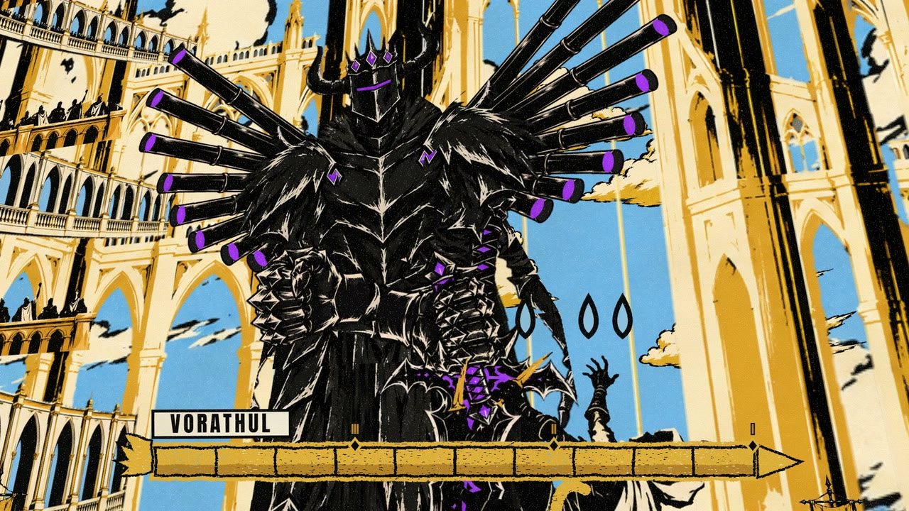
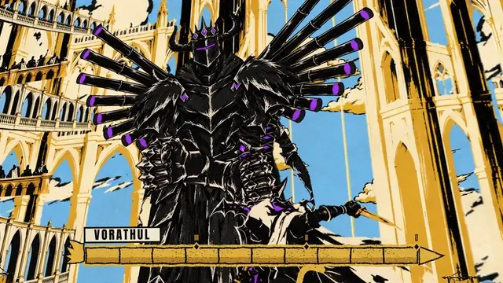
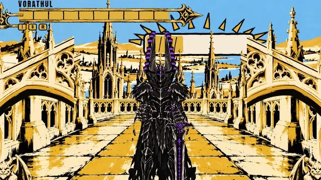
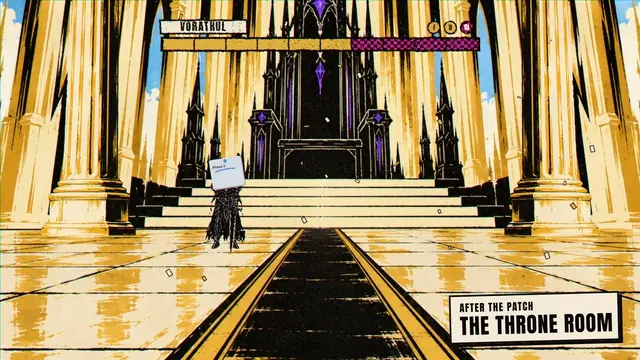
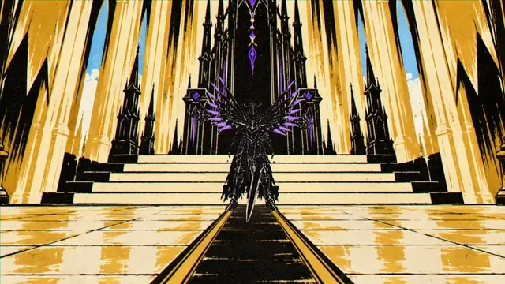
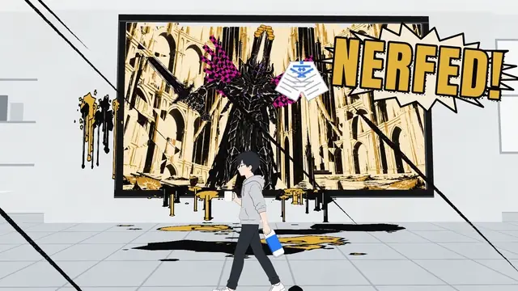

# Vorathul: NERFED



*NERFED* is a 4:33 symphonic metal anthem about a final boss who gets nerfed in a patch. The film puts a
god of a painted world, a black knight called Vorathul, inside a painting that hangs on the wall of a game
studio. Developers change him through the painting. Their patches land in his world as health bars, deleted
wings and a stamp that says NERFED. He slowly notices the sky is a canvas, and in the final chorus he
breaks out of the frame and floods the flat grey office with black ink and gold paint.

Final render: 2560x1440, 60 fps, 16,430 frames, 273.83 s. Song made with Suno (Pro). The video code and assets
are in this folder; the song and the finished video are not in git (see Known issues).

## Excerpts

Each excerpt is 3.5 s from the final render, shown at 15 fps.

<table>
<tr>
<td width="50%" valign="top"><br>
<b>0:30</b> The riff fight. Close on the pipe-organ wings, a wide shot with an impact burst, a comic-panel insert.</td>
<td width="50%" valign="top"><br>
<b>1:14</b> The sunrise is a progress bar. The camera pulls back through the frame and the painting hangs on an office wall.</td>
</tr>
<tr>
<td width="50%" valign="top"><br>
<b>1:40</b> After the patch. The NERFED stamp lands; "Health -40 %" and "Meteor Rain: removed" stand as grave stones.</td>
<td width="50%" valign="top"><br>
<b>2:01</b> Verse 2, one deletion per line. The wings are selected and deleted; the missing-texture checkerboard takes their exact shape.</td>
</tr>
<tr>
<td width="50%" valign="top"><br>
<b>3:49</b> Final chorus. A NERFED! balloon on the office wall, then he bursts out of the painting.</td>
</tr>
</table>

## How it was made

One person directed. Claude Opus 5.5 (Claude Code main loop) was the architect: it measured the song, wrote
the contracts and checks, split the work and verified the results. Sub-agents built separate parts in
parallel lanes: an Opus lane for the effects library and Sonnet lanes for the office UI kit and the rig. Every
picture came from Codex image generation or from code. Dates are 20 and 21 October 2026.

The longer write-up, with every image round, is in
[`docs/making-of/`](docs/making-of/01-from-song-to-style.md). This is the short version.

### Pipeline

1. **Pick and measure the song.** Two Suno songs were candidates; this one won because its lyrics already
   describe pictures ("health reduced by forty percent", "can now be skipped"), it has one main character,
   and it has an emotional turn. `tools/timing/` (librosa, faster-whisper, demucs stems) measured it before
   any picture. The prompt given to Suno is a claim, not a fact:

   | Claim in the Suno prompt | Measured |
   |---|---|
   | 170 BPM | about 186 BPM in 7 of 11 segments; the interlude slows to 176.6 |
   | Key change up in the final chorus | none (chroma correlation 0.955 at shift 0, 0.366 at +2 semitones) |
   | Music stops for the announcer | the band drops 10 to 14 dB; the only true silence is 78.3 to 78.8 s |
   | not in the lyrics | a 28 s wordless riff at 0:21 to 0:49 |

   With no key change and a flat-loud mix, the climax has to be visual. The wordless riff became the boss
   fight. Every joke is bound to a measured word time. Gemini listened too and was wrong on numbers
   (a +2 semitone key change, 155 to 170 BPM, "total silence"), so only the scripts count as measurement.
2. **Story, then style.** The story: a gothic painted world and a sterile software office, and a painting of
   the game on the office wall. The director added that Vorathul crosses into the office at the end.
   `docs/scene-map.md` is the contract: 17 scenes bound to measured anchors, and an awareness ladder
   (he looks up, sees a straight frame edge, puts his gauntlet on the inside of the canvas, cracks it,
   breaks out). Six image rounds found the look (below).
3. **Storyboards, then code.** Two storyboards cover 115 shots (S01 to S115), each tied to a measured word or
   hit, a building block and a palette. Later storyboards added a location for each fight phase, the
   developer and props, an empty cathedral, and the office converting into his world.
4. **Build in lanes.** Each lane got its own folder, entry point and list of files it may touch, so two lanes
   could not collide. The main loop connected them. The stack is Remotion and Three.js, used as a 2.5D card
   stage: every drawing is a flat unlit texture on a plane, layered in depth for parallax and camera moves,
   with one WebGL canvas per frame. Vorathul is a cut-out puppet (`docs/rig.md`): separate parts rotating
   around joints, never one drawing morphing into another.
5. **Check, render, repair.** See Checks below. The final render runs twice and the two are compared.
6. **60 fps.** `Nerfed60` renders the 30 fps scene clock at 60 fps with fractional frames (commits
   `be2a308`, `b0eaad9`, `25cd4f8`). Typography is timed by the 30 fps scene clock, and several 2D overlays
   moved from twos to ones.

### Finding Vorathul: six image rounds

Every round used one prompt per image, all in parallel, then a contact sheet, then the director picked.

- **Round 1**, baroque oil painting: epic, but gold and ember and generic.
- **Round 2**, "pitch black and dark purple": purple took over everything. The director asked for a matte
  black body with purple only on crown, weapon and trims, and the world painted in opposite colours so he
  reads as a black hole in it.
- **Round 3**, matte black knight in a golden world: the black-hole effect worked and the character design
  was approved. The director's verdict on the look: too polished and too realistic, "just ChatGPT's default
  image look". That was the image model's house style.
- **Round 4**, the same scene in five techniques (manuscript, engraving, graphic noir comic, stained glass,
  tarot). The comic won: the flat black mass keeps the black hole strongest, and flat fills with hard edges
  cut cleanly into rig parts. Engraving was beautiful but fine hatching shimmers in compressed video.
- **Round 5**, the comic style with character states. The first second form was too weak; the wings read as
  towers. Two wing designs were tried and the pipe fan won, because every pipe is a separate part that can
  be deleted, corked or relit. The nerfed state became a missing-texture checkerboard (magenta `#E0129A`,
  used only for deleted things) in the exact shape of the wing fan.
- **Round 6**, one canonical turnaround sheet, because the character drifted between images. A fixed feature
  list (`stil/onayli/KARAKTER.md`) is repeated in every prompt, with the style frame and the sheet as
  references on every call. Approved frames and their prompts are in `stil/onayli/`.

### What was tried and dropped

- **Realistic, polished art** (rounds 1 to 3), for the "default image look" reason above.
- **Engraving style**, for shimmering hatching.
- **A single location for the whole painting world.** The first build used one set; it was rebuilt with a
  location per phase (nave, cathedral rooftop, organ loft, crumbling throne room, empty cathedral) and real
  drawn hero panels instead of code-drawn ones.
- **Flat gold light-ray strips**, replaced by a painted light layer. Strike echoes on the drawn rig were
  dropped (`e37121f`), and displacement filters in two shots were replaced by drawn bulge marks (`229394f`).
- **Off-axis cameras.** Cameras are kept within 15 degrees of frontal; a gate in `PaintingShot` enforces it
  for part 1 (`0b16873`, `2960f80`).
- **Ducking the song.** "Volume reduced" is shown visually (he clutches his throat, a wisp of smoke leaves
  the corked pipes); the audio is never lowered.
- **Rig cadence.** A study of a published animated music video (not named here, no frames included) suggested
  characters on twos (15 fps) and overlays on twos. The scene map and rig design adopted that, then
  `7451f9f` made the rig cadence ones by default and `c9ab4e0` and `0f5ff51` moved the 2D overlays to
  ones. Only seeded noise stays on twos. The study found 53 % of that video's cuts within 1.5 frames of a half-beat
  grid against 32 % expected by chance, so cuts there are only loosely tied to the beat. Here they are tied
  exactly.

### Mistakes that a script caught

- **Parallel image jobs copied a neighbour's picture.** Two output files had the same size and minute;
  `md5sum` showed they were identical. Every round is now md5-checked.
- **A flash counter that disagreed with itself.** The effects library counted one flash as a pair of
  luminance swings; `tools/flashcheck.py` counts each swing, which is stricter. The gallery ran at 4 to 5
  flashes per second by the strict count and failed while passing the helper. Both now count each swing.
  A read-only audit of the storyboards (`docs/flash-audit.md`) counted 94 planned flash sources and 141
  swings before any scene was built.
- **Mosaic frames in renders.** Some frames came out as the picture tiled into small copies. Single-frame
  renders were always clean. Four Remotion processes from a night session were still running, which fits the
  pattern but is not proven as the only cause. Final renders now run twice at concurrency 1 and
  `tools/glitchcheck.py` compares them.
- **Claude's first read was wrong.** From 12 frames it said the reference characters barely move; measurement
  showed small, continuous motion on every frame.
- **Four legs.** A render of the finished film showed four legs. Commit `270bc93` paints the master's legs
  out of the drawn cape so the rig shows two.

### Checks

- `npm run beatcheck`: every event frame is recomputed from `data/timing.json` and must match with 0 drift;
  dead air is limited to 2 beats in intro, chorus, build and finale and 4 in verses. One frame (about 0.10
  beat) of rounding is accepted and the reason is written into the check. I reran it for this README:
  "drift PASS, dead air PASS".
- `npm run purity`: no `Math.random`, `Date.now`, timers or `requestAnimationFrame` in the source, so a
  frame renders the same every time.
- `tools/flashcheck.py`: at most 3 flashes in any second, each luminance swing counted as one flash, with
  a synthetic self-test. I ran it on the delivered 1440p60 file: general flash PASS (worst window of 3
  flashes at 1:25), red flash PASS.
- `tools/rigcheck.mjs`: the rig test plan as a PASS/FAIL table.
- `tools/render_film.py`: renders twice, diffs both renders frame by frame, re-renders disputed frames as
  stills, splices them in, then runs the glitch and flash checks.

## Layout

- `sarki/sozler.md` lyrics and the Suno style prompt; `sarki/suno-v2.md` a second prompt drafted from the
  measured results
- `audio/` song files (not in git; see Known issues)
- `tools/timing/` song measurement (tempo, downbeats, sections, word timings)
- `data/timing.json` measured timing used by the video
- `stil/onayli/` approved style frames and their prompts
- `docs/` scene map, storyboards, rig design, typography, flash audit, making-of
- `video/src/` Remotion project: `stage/`, `rig/`, `vfx/`, `ui/`, `camera/`, `film/`

## Success metric

Every beat-locked event lands on its beat with **0 frames drift**, no section breaks the dead-air rule
(`tools/beatcheck.mjs`), and the full render has **0 render errors**.

## Running it

```
gh release download vorathul-audio-input -p "Vorathul.Nerfed.wav" -D audio   # audio is gitignored (*.wav)
mkdir -p video/public/audio && cp audio/Vorathul.Nerfed.wav video/public/audio/song.wav
cd video && npm ci
npm run sync-timing   # copy ../data/timing.json into src/data/
npm run studio        # preview
npm run check         # tsc --noEmit
npm run purity        # frame-purity grep over src
npm run beatcheck     # drift + dead-air check against data/timing.json
npm run stills -- --frames 0,585,2349 --comp Nerfed
npm run render:test30
```

Full film at 60 fps (needs ffmpeg, Pillow and uv; docstring of `tools/render_film.py`):

```
python tools/render_film.py --entry src/index.ts --comp Nerfed60 --frames 0-16429 --out out/nerfed60.mp4 --song public/audio/song.wav
```

## Known issues

- **The song release is a draft.** `gh release view` shows the audio as a draft release tagged
  `vorathul-audio-input` (asset `Vorathul.Nerfed.wav`, 52.6 MB). Drafts are not visible to the public, so
  nobody else can download the song until it is published. The command above uses that tag; this README
  used to say `audio-input`.
- **The final video is not attached to a release yet.**
- The delivered file is 2560x1440 but the Remotion compositions are 1920x1080 (`W` and `H` in
  `video/src/Root.tsx`). The repo does not record how the 1440p copy was made.
- The making-of has parts 1 and 2 only, and part 2 still carries TODO comments for the later VFX rounds and
  the rig result.
- Sound effects: 65 candidates exist in `sfx/candidates/`. The repo does not record a choice.
