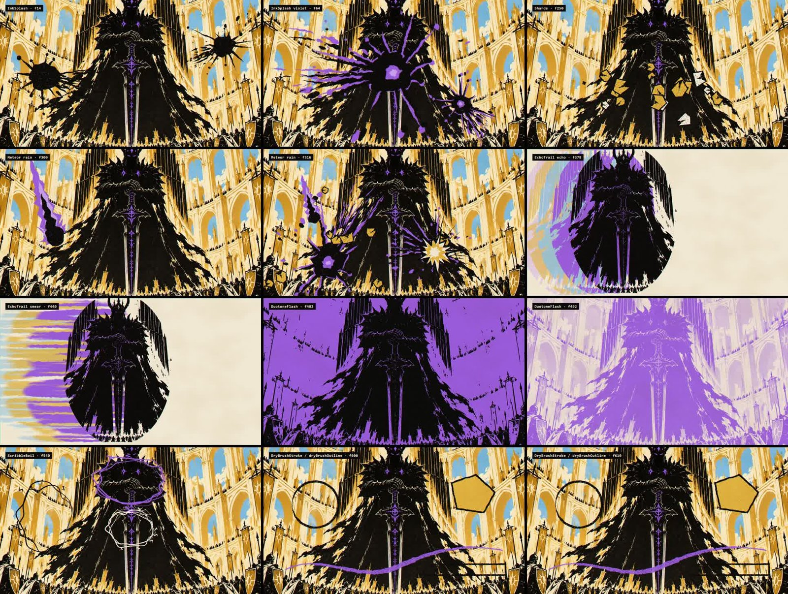
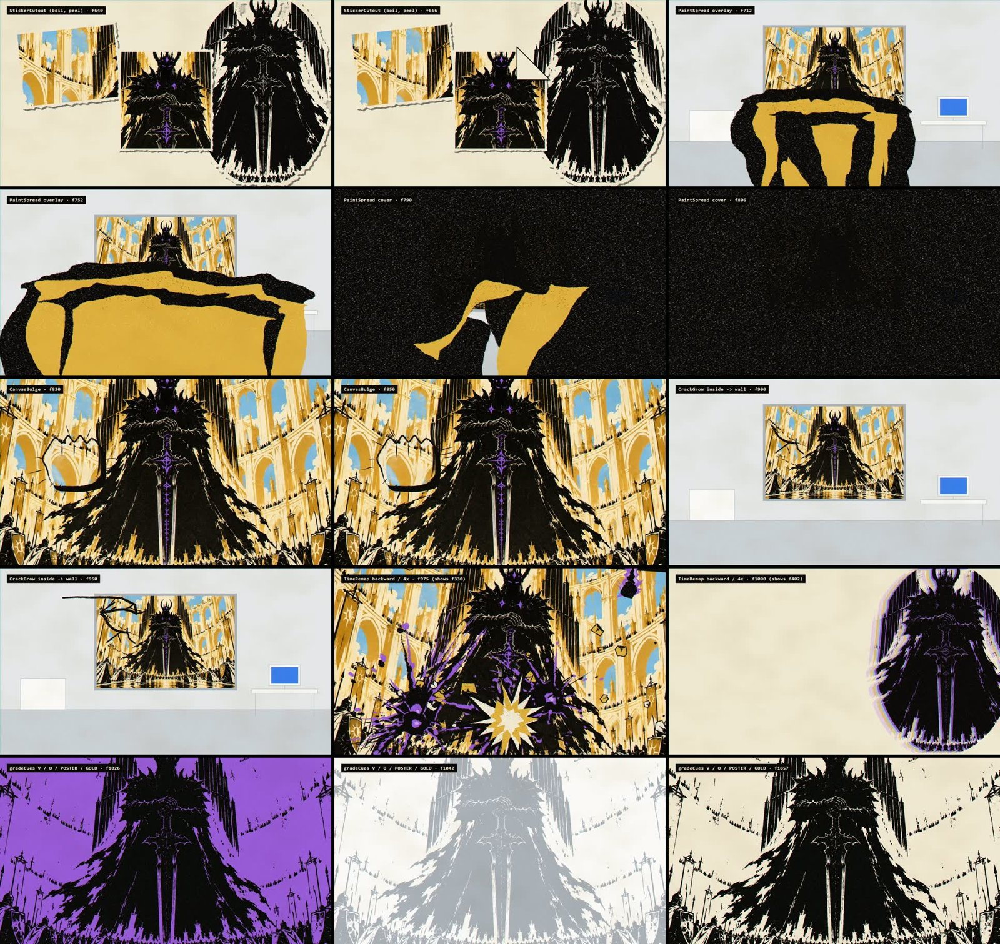
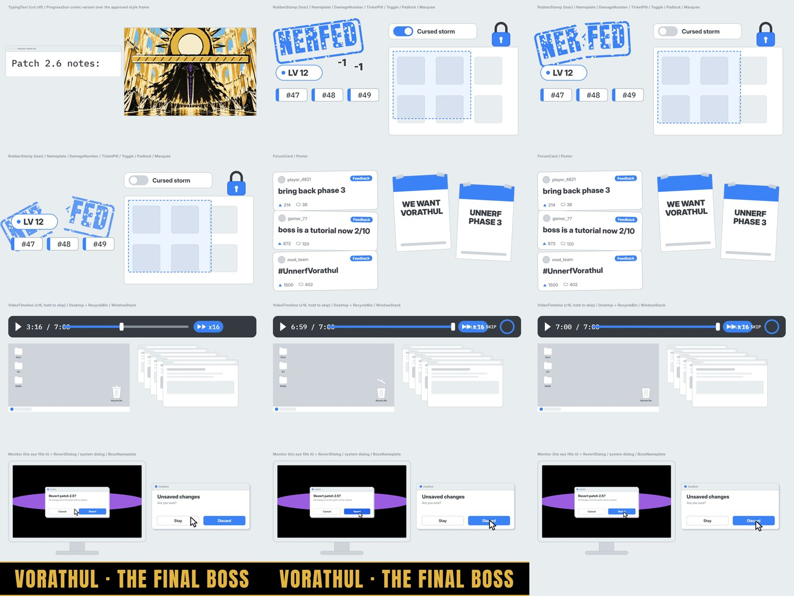
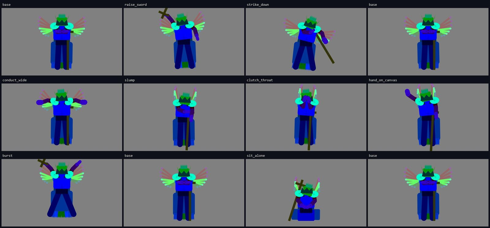

# Making-of, part 2: from an approved style to building blocks

*20 October 2026 · same long session, Burak directing, Claude Code (Opus) as the main loop that
writes the contracts and checks the work; the building lanes ran as separate sub-agents (an Opus
lane for the VFX library, Sonnet lanes for the office UI kit and the rig).*

Part 1 ended with an approved look. This part is about turning it into something a video can be
assembled from, without drawing a single finished shot by hand. Honest version again: what we
wrote down first, what we built in parallel, and which mistakes a script caught.

## 1. Two storyboards before any scene code

The scene map ([`docs/scene-map.md`](../scene-map.md)) has 17 scenes tied to measured times. That is
too coarse to build from, so we wrote two storyboards, one shot at a time:

- [`storyboard-01`](../storyboard-01-intro-to-unfair.md): intro to the "UNFAIR" scream, 45 shots, 53 assets.
- [`storyboard-02`](../storyboard-02-chorus-to-end.md): chorus 1 to the end card, 70 shots (S46-S115),
  13 attacks in 8 different styles, 29 planned colour collisions, 44 assets.

Every shot lists its frame range, the measured word or hit it is bound to, which building block
draws it, and which palette it lives in. The point of the long list is the **contract**: a lane that
builds "an ink splash" knows which frames will call it and with what colours, so nobody has to
guess what the integration step will ask for.

After each storyboard the main loop wrote an "Architect decisions" section. These are the
decisions that changed the plan:

- **The painting is 16:9**, the video's own ratio, so the cut from "inside the painting" to "the
  office wall" is invisible.
- **The eraser the developer uses is office-coloured** (white, grey, UI blue). The pink in one
  generated frame was a generation slip; magenta stays reserved for deleted things only.
- **Violet is Vorathul's energy, not just trim.** It was first limited to the eye slit, crown
  gems, chest studs, pipe mouths and sword runes; his attacks, meteor trails and second-form
  cracks are violet too.
- **Fonts:** Inter and IBM Plex Mono for the office UI, Anton for big comic captions, all under the
  SIL Open Font Licence. No handwriting face: the office has to feel sterile.
- **A strict flash rule** (section 6 below).
- **Test the risky parts first:** a four-hero image test round before the other 26 images, and the
  heaviest render (the breakout) first, as a load test.

Some questions no measurement could answer went onto a list for Burak's listening check: where
"Of" really starts (74.48 s, low confidence), which of two measured times the first "Patch" has
(77.76 from the mix, 79.14 from the vocal stem; we used 79.14), and whether the strikes under the
choruses land by ear, since there are no measured onsets there.

## 2. The first check: beats, not eyes

All events live in one schedule file. `tools/beatcheck.mjs` recomputes every expected frame from
the raw timing data, independently of the code that placed it, and fails on any drift. It also
enforces the dead-air rule from the scene map (no more than 2 beats without an event in the
intro, chorus, build and finale; 4 in verses).

One tolerance needed a decision. Storyboard 01 measured gaps of **2.03 to 2.07 beats** in places
that were meant to be exactly 2. Events sit on whole frames, so rounding both ends of a 2-beat gap
at 30 fps and ~186 BPM costs up to a frame. The choice was between inventing filler events to
shorten the gap, or accepting the rounding. We accepted exactly one frame (about 0.10 beat) of
tolerance and nothing more, and wrote the reason into the check itself. Filler keys that mean
nothing are worse than a rounding error.

## 3. Building in parallel lanes

Each lane got its own folder, its own entry point (`src/vfx/index.ts`, `src/ui/index.ts`,
`src/rig/index.ts`) and a list of files it may touch. Only the main loop connects them in `Root.tsx`.
That is what made parallel work safe: two lanes cannot collide on a file that only one of them
owns.

Rules every lane had to follow, written into the contract:

- Frame-pure code: no `Math.random`, `Date.now`, timers or `requestAnimationFrame`. Anything
  random is seeded, so a frame renders the same every time.
- No JSX constants at module level. The bundle compiles JSX to `React.createElement` and `React` is
  not defined yet while the modules load, so such a constant crashes the whole bundle.

### 3.1 The VFX library (Opus lane, three rounds so far)

Comic effects written as code, previewed in a gallery that renders each effect at chosen frames:
ink splashes, speed lines, impact bursts with a posterised flash, shards, meteors with trails, screen
shake, a dry-brush stroke and outline, echo trails, a two-colour flash, scribble boil. Round 3
added what storyboard 2 asked for: a torn-paper sticker cut-out, a gauntlet bulging out of a flat
painting, an ink-and-gold paint flood, a crack that can escape its card, time reversal and grade
cues.

 

Burak looked at the contact sheets and gave verdicts we kept as they were:

- The **paint spread** looked like "a wrapped yellow thing, like a bug." In the right sheet it is
  the gold slab with black rags over the office wall (end of the first row, start of the second).
- The flat white **office grade** was "just flat whitening."
- The **violet grade** and the soft **ivory and sky-blue "memory" grade** were his favourites.
  Those two are marked untouchable for the next round.

The main loop's own read, before Burak's: the sticker cut-out is good, the bulge is weak and the
crack is thin. Those two are noted, not fixed yet.

<!-- TODO: VFX round 4 is still running (paint spread redone, three attempts at an office grade,
the last one built on the memory-grade logic). Fill in what came out and what Burak said. -->

### 3.2 The office UI kit (Sonnet lane, finished)

The sterile flat world as React components: patch notes card, health bar, cursor, sticky note,
skip button, volume slider, revert dialog, a progress bar that is also the sun, typed text, the
missing-texture checkerboard, a rubber stamp, forum cards, posters, a toggle, a video timeline,
name plates, damage numbers, ticket pills, a marquee, a padlock, a recycle bin, a desktop, a window
stack, a monitor and a boss name plate. Thin uniform lines, one UI blue. It passed the flash check.

This sheet was rendered two minutes before the lane's last commit: in the right two columns of the
third row the "x16" badge still sits on top of "HOLD TO SKIP". The commit fixed it; a still rendered
from the current code shows the badge and the label side by side.

### 3.3 The rig (Sonnet lane, still running)

Vorathul is a cut-out puppet: separate parts rotating around joints, not a drawing morphing into
another drawing. [`docs/rig.md`](../rig.md) is the design document; section 9 holds the architect
decisions:

- **True twos.** A new body pose every 2 frames at 30 fps, i.e. 15 fps, not 12. An even cadence
  cannot judder against the 30 fps camera.
- **Helm halves are cut from the closed helm**, so nothing pops when it splits. The inner rim of
  the open helm is drawn in code along each cut with the same dry-brush stroke the VFX library
  uses, so nothing is generated twice.
- **The checkerboard wing is the outline of the deleted pipe fan** (the union of the 16 pipes),
  filled with the magenta checkerboard. Burak chose this: it reads as the missing texture of
  exactly what was deleted and always matches the fan.
- **Python helpers use temporary environments**, like the timing tools, so the repo gains no new
  dependency.

That is the engine moving **placeholder** parts (flat coloured shapes, not our drawings) through
named poses: raise sword, strike, conduct, slump, clutch throat, hand on canvas, burst, sit alone,
with the base pose between them. The real drawings come later.

<!-- TODO: rig is still being built. Add: the measured result of the rig check, and the first frame
with the real drawn parts. -->

### 3.4 Sound effects (candidates, Burak has not chosen)

Thirteen moments (A to M), each with five candidates: **65 in total**. They are built from free
Kenney CC0 sound packs (impact, interface, UI, RPG, sci-fi) or synthesised in numpy; every source
and licence is in `sfx/candidates/SOURCES.md`. Each candidate has its gain set to a target 12 dB
under the song's local loudness, and an in-song preview cut so Burak hears it against the real
mix in stereo. The first moment, for example, sits on the 19.55 s band entry.

The song itself is not committed; the previews are for listening only. The choice is Burak's:
the listening page `sfx/candidates/index.html` takes picks like "A2 B5 ...".

<!-- TODO: add Burak's picks when they arrive. -->

## 4. What the Arcane study changed

The next clip wants the visual language of a well-known animated music video, so before building
more we measured how it is made. We do not publish its frames; they belong to the studio. What
follows is only what the numbers said (3:33 long, 24 fps, about 77 BPM by a cut-grid fit).

- **From 2:18 on it is a graphics layer.** Cutting gets about 2.5x faster (median 2.3 s between
  hard cuts before, about 0.9 s after), with flat saturated backdrops, cut-out collages, scribbles
  and colour splits. That is mostly compositing, which our stack can approach: our judgement is
  about 60-70 % reachable in code. The first 2:18 is expensive 3D acting and lighting, which it
  cannot.
- **Characters move on ones, 2D overlays on twos.** Measured as frame-to-frame difference in
  cropped regions: faces changed on every frame, static backgrounds read about zero, and collage
  and scribble layers alternated big and small differences (34/10/37/16/...), i.e. each drawing is
  held for two frames.
- **Cuts are only loosely tied to the beat:** 53 % within 1.5 frames of a half-beat grid, against
  32 % expected by chance, and the same ratio before and after 2:18.

Two mistakes in how we got there, both worth keeping:

- **Claude's own first claim was wrong.** From a 12-frame look it said the characters barely
  move. Measurement showed small but continuous motion on every frame. Small is not still.
- **Gemini got the numbers wrong again**, as in part 1. All nine detailed passes said characters
  on twos and effects on ones, the opposite of the measurement; its tempo guesses spread over
  seven values between 75 and 150; and overview timestamps were 1-3 s off. It did catch the
  collage start and a glitch transition, so it is useful for finding where to look and bad for
  numbers.

What we took from it, applied to Vorathul and **not yet verified in a finished shot**: big body
poses on twos (15 fps), a small "life" layer on every frame (breathing, cape, glow flicker), and
2D overlays (ink, scribbles, collage) on twos. These are written into the scene map and the rig
request.

## 5. A render that looked fine and was not

The VFX gallery render came out with some frames showing the picture as tiled, repeated small
copies, a "capture mosaic". Single-frame renders of the same effects were always clean. One full
render had at least 14 such frames; later renders had a few (5 and 2 in one pair) or none, and never
on the same frame twice.

When we looked at the process list, **four Remotion processes left over from a night session
were still running** while the gallery rendered. We cannot prove they were the only cause, but
the pattern fits. Rules since then:

- A final render runs **twice**, and `tools/glitchcheck.py` compares the two. A frame counts as a
  glitch in one render only if it differs strongly from the other render at the same index
  **and** from both of its own neighbours; real cuts differ from their neighbours in both renders,
  so they do not trip it.
- No other render runs at the same time.

Closing the hung processes was refused by the permission layer in the session; the command was
handed to Burak and has not been confirmed.

## 6. A flash counter that disagreed with itself

The contract has a hard photosensitivity rule: no more than 3 flashes in any one second. Two
pieces of code counted "a flash" differently, and we found it only because a second, independent
tool existed.

- The helper inside the effects library first counted one flash as a **pair** of luminance swings
  (dark, bright, dark). That is 6 swings per second for the same limit.
- `tools/flashcheck.py` counts **each swing** as a flash, which is stricter than the WCAG reading
  and was kept stricter on purpose. By that count the gallery ran at **4-5 flashes per second**
  over 44-99 % of the screen and **failed**, while it had passed the helper.

The fix was to make both count each swing, then respace the gallery's flashes until the tool
passed. The tool carries a synthetic self-test, so we know it can see a real strobe before we
trust a pass.

Still open: two planned places in the storyboards (the biggest blast near the end, a white-out followed
by one hard colour grade per beat, and a six-panel colour sequence in the final fight) may exceed the budget under the strict count.
The grade helper now throws instead of passing quietly, so they must be respaced when those scenes
are built.

## 7. What is not done

- The real drawings for the rig and the storyboard assets: image generation comes next, from the
  approved sheet of part 1.
- The camera lane (presets, shake with overscan) is still being built.
- The first scene: the black-hole opening with a placeholder puppet, then the beat, flash and
  glitch checks on its render.

<!-- TODO: link part 3 once the first scene renders. -->
